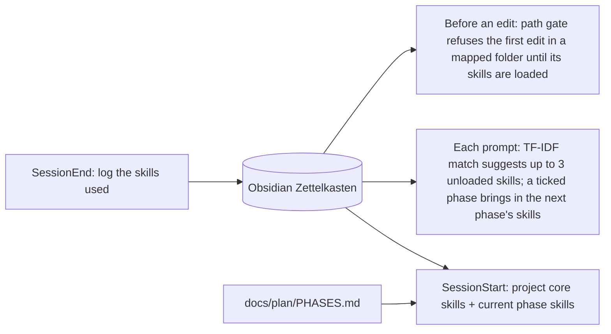

# How AI is used to build strongChar

strongChar is built by one person (Rounak) working with an AI coding agent (Claude Code, Anthropic). This file is a running log, updated as the work happens, not written at the end.

## Workflow

1. **Rounak decides.** Every product decision (category, scope, token, hosting, cut order, wording) is asked and answered explicitly; the agent does not assume. Decisions are numbered in [docs/plan/MEMORY.md](docs/plan/MEMORY.md) with the reason for each.
2. **The agent researches and plans.** It reads the event rules, FAQ and chain parameters, checks package registries, and drafts the plan in [docs/plan/](docs/plan/) (PRD, architecture, design, phases, rules, memory).
3. **The agent verifies before it builds.** Unknowns are turned into small spikes that run against the real testnet (free `eth_call` where possible) and their results are written to MEMORY.md before code depends on them.
4. **The agent writes code and tests; Rounak reviews and merges.** Work lands on a branch per task with tests, CI runs, and Rounak approves the merge.
5. **Anything outward-facing waits for Rounak.** Publishing, spending testnet funds or cloud credits, wallet transfers and approvals are done by Rounak or only after Rounak says so.

## The skill system: a Zettelkasten that steers the agent

A coding agent is only as good as the expertise it brings to each step. Rounak built a personal knowledge system so the agent picks up the right expertise at the right moment by itself, instead of relying on whatever it happens to remember.

**The library.** Every agent skill (a packaged playbook such as `applied-cryptography`, `solidity-security` or `remotion-best-practices`) is indexed in an Obsidian vault built as a Zettelkasten: 1,836 skills in all, 527 active, 80 from plugins and 1,229 in cold storage that can be restored with one command.

| Layer | What it holds |
|---|---|
| Atomic notes | One note per skill: how to invoke it, its domains, linked related skills, and Rounak's own notes on what worked (kept across rebuilds) |
| 22 maps of content | One per domain: cryptography and blockchain, distributed systems, AppSec, frontend, ML and others |
| 16 workflow notes | Ordered skill chains for recurring jobs, for example *Crypto and PQC Implementation*: choose primitives → constant-time and zeroize checks → property tests |
| Index and Base | A tab-separated index for fast lookup, and an Obsidian Base for browsing and filtering |
| Project notes | One per repository, with its stack, workflows, core skills and an automatic usage log |

A build script regenerates the vault from the live skill folders, so the graph never drifts from what the agent can actually load.

**How it drives the agent.** Four hooks in Claude Code connect the vault to every session:

1. **Session start.** It reads the project's skill block and the plan, finds the active phase in `docs/plan/PHASES.md` (the furthest phase with ticked work that is still open, or else the next open one) and lists earlier phases left unfinished, and tells the agent which skills to load for that phase.
2. **Every prompt.** A TF-IDF matcher over the skill index suggests up to three skills that fit the request and aren't loaded yet. When a phase gets ticked off, the next phase's skills are announced.
3. **Before every edit.** Path triggers map folders to the expertise they need. The first edit in a mapped folder is refused until those skills are loaded.
4. **Session end.** The skills a session used are written back into the project note and linked from each skill's note, so the vault records which skills actually paid off on which project.

**Configured for strongChar** (with the `project-skills-setup` skill, which scans the repo and writes the configuration):

- Workflows: *Crypto and PQC Implementation*, *Smart Contracts and Blockchain*, *Security Audit*.
- Ten core skills, each with a reason tied to this repo. For example, `applied-cryptography` covers QoreSeal sealing and ML-DSA-87 verdicts, `distributed-systems-design` covers two-verifier replay and slashing under failure, and `eris-leakage-auditor` keeps hidden competition labels from leaking.
- Path triggers:

  | Path | Skill that must be loaded first |
  |---|---|
  | `contracts/src/*` | `solidity-security` |
  | `contracts/test/*` | `web3-testing` |
  | `packages/qore/*` | `applied-cryptography` |
  | `packages/*/tests/*` | `property-based-testing` |
  | `sandbox/*`, `docker/*` | `docker-patterns` |
  | `video/src/*` | `remotion-best-practices` |
  | `video/scripts/record*` | `ui-demo` |
- A phase map: each build phase in the plan lists the skills it needs. The final phase, Ship, loads the video, UI demo, deployment and security-audit skills.

The effect is that the agent can't touch the escrow contract without the Solidity security playbook loaded, or the sealing code without the cryptography one. When the project moved from contracts to the web app to the film, the expertise moved with it without anyone asking. One working session on 21 Nov drew on 19 different skills, all logged back into the vault.

## What the agent generated

| Date | Work | Human contribution |
|---|---|---|
| 18 Nov | Research on the event, rules and chain; the full plan in docs/plan | Chose category, scope, token name, hosting, design direction; answered every open question |
| 18 Nov | Red-team review of the plan (security, rules, schedule) and the resulting fixes D20–D34 | Chose two-VM hosting, the tagline, the cut order |
| 18 Nov | AWS CLI and agent toolkit setup; hosting cost check | Created the AWS project, signed in, picked the help level |
| 18 Nov | Public repo, project page form, GitHub App selection | Approved publishing, clicked Install on the GitHub App |
| 18 Nov | Phase 0 scaffolding: uv and pnpm workspaces, Foundry, CI, key store with tests, `PQ` precompile library with tests | Reviewed; told the agent to merge |
| 18 Nov | Spike S2: found `pqcVerify`'s exact message format with live `eth_call`s and measured its gas | — |
| 18 Nov | Chain wrapper (simulate, hybrid sign, broadcast, confirm); proof-of-possession key registration and funding for 11 actors | Funded the deployer from QoreX |
| 18 Nov | Spikes S1, S3, S4 on testnet: windows, QoreSeal key registration and recipient cards, AMM limits; found and fixed a wrong window rule in the plan and a private-key leak in object printing | Chooses what BERU is for |
| 18 Nov | Spike S5: pinned sandbox image, determinism runs on x86 and arm64 under gVisor; proposed canonicalising predictions | — |
| 18 Nov | Listed the 5 project addresses and ran the Ship Weeks checks (all four badges earned) | — |
| 18 Nov | Phase 1 core, workloads and datasets packages with tests; cross-checked the deterministic maths bit for bit and the training self-test on x86 and arm64; synthetic health dataset | Approved starting Phase 1 |
| 18–19 Nov | Contracts (Beru token and faucet, NodeRegistry, JobMarket) with 25 Foundry tests; deploy script; deployed to diana with a live signature check | Reviewed and approved the merge and the deploy |
| 19 Nov | Phase 2: contract client and window manager, coordinator (ML-DSA login, recipient-only blob reads, keeper), node and verifier services, demo job run end to end on diana; found and fixed the fUSD bank-coin vs ERC-20 split, a shared-IP rate limit and a verifier submit race | Asked for continuous work with self-review and merging |
| 19 Nov | Phase 3: sandbox runner with containment tests, deterministic metrics, Competitions contract with tests, verifier competition loop, competition demo | Deploy held for approval |
| 19 Nov | Phase 4 read-only web app: tokens, components, live jobs, nodes and sealed-store pages | — |
| 19 Nov | Deploy files (service image, per-server compose, per-actor key files); competition pages; found that diana caps log queries at 10,000 blocks and fixed every reader; found and fixed a competition script leaking test features through its published crash message; threat model | Asked for continuous work across phases |
| 18 Nov | AWS servers following AWS's EC2 launch guidance; found the Free plan refuses `t4g.medium` and proposed alternatives with prices; bootstrap script with gVisor | Approved spending, chose two small worker servers |
| 21 Nov | Feature update series for the project page (one post per feature, each with a still from the film); hackathon rules check; README credits and a section on where encryption happens | Asked for the series and the rules check, approved the wording and the 30-minute schedule |
| 21 Nov | Showcase film: a Remotion project replaying live job 4 from the servers' own logs; narration and sound effects generated with ElevenLabs (voice: ElevenLabs, elevenlabs.io); the score composed in code to the scene timeline; screen recordings of the live web app with Playwright. Opening-shot drafts were generated with Google Flow and then replaced by an animation built in code, so the final film contains no generated video | Directed every revision: a stronger hook, smoother camera, livelier training and job-posting scenes, quieter mid-film music, a new opening; approved the result |

## Where AI was not trusted blindly

- Chain behaviour (message format for `pqcVerify`, windows, randomness, key status) is measured on the testnet, not assumed from documentation.
- Claims in the README and on the project page are checked against what the code and chain actually do (for example the tagline was corrected because it overstated who can read data).
