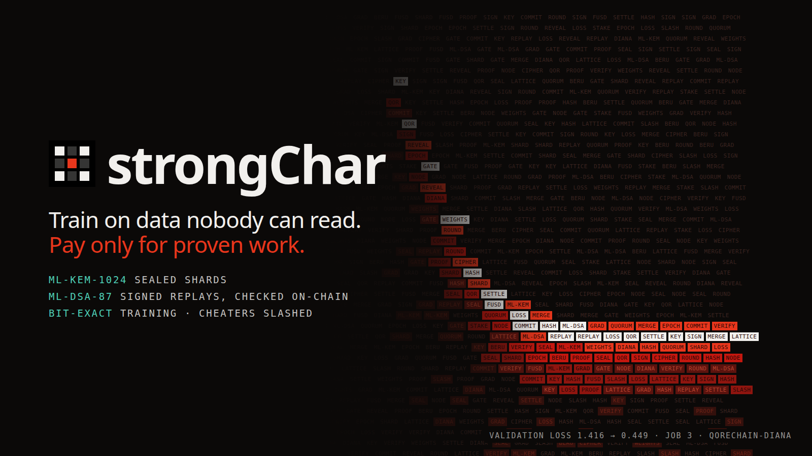

# strongChar



[](https://build.qorechain.io/p/strongchar)

**Your data, sealed to only the machines that need it. Every step proven.**

Train models on private data using other people's computers, and run Kaggle-style competitions where the hidden test set never leaks.

- Every byte of data is sealed with post-quantum encryption (ML-KEM-1024, QoreSeal) to only the node and verifiers that work on it. The server in the middle only ever stores ciphertext.
- Two verifiers replay every step exactly; their verdicts are post-quantum signed (ML-DSA-87) and checked on-chain with QoreChain's `pqcVerify` precompile.
- Money moves only inside scoped EVM windows.

Built for **Build Before Q-Day: The QoreChain Developer Fest** (category: Encrypted Apps), on testnet `qorechain-diana`.

### Encrypted Apps requirements, and where to see each one

| Requirement | How strongChar meets it | See it live |
|---|---|---|
| ML-KEM-1024 encryption | Every shard, validation split, model, competition test set and script is a QoreSeal envelope (ML-KEM-1024 with X25519), sealed to named QoreChain addresses only | [What the server sees](https://strongchar.vercel.app/sealed): the coordinator's whole store, ciphertext only |
| Registered recipient keys | Nothing is sealed to an address unless it has registered an ML-KEM-1024 key on chain (`MsgRegisterKEMKey`); the browser and the CLI both refuse otherwise | [Your account](https://strongchar.vercel.app/account) registers yours in three steps |
| ML-DSA key binding | Each recipient card (ML-KEM-1024 and X25519 keys) is signed with the address's secp256k1 and ML-DSA-87 keys and checked against its registered, possession-proven ML-DSA-87 key before sealing. The verifiers' ML-DSA-87 signatures on every settlement are checked on chain by `pqcVerify` | [Job 5](https://strongchar.vercel.app/jobs/5): **Check the signatures yourself** re-verifies them from your browser |
| Client-side encryption and decryption | The owner seals in the browser and opens the trained model there; nodes and verifiers seal and open on their own machines. The server in the middle never encrypts or decrypts | [Post a job](https://strongchar.vercel.app/jobs/new) and [host a competition](https://strongchar.vercel.app/compete/new) seal before anything is uploaded |

Details per step: [Where encryption happens](#where-encryption-happens).

**Live:** web app at [strongchar.vercel.app](https://strongchar.vercel.app), coordinator at `https://32-237-26-58.sslip.io`, all on testnet `qorechain-diana`. The plan lives in [`docs/plan/`](docs/plan/).

## Deployed on qorechain-diana (EVM chain 9800)

| Contract | Address |
|---|---|
| JobMarket | `0x03b2956fAd7A45E19067569FF1d4AC266758bc84` |
| NodeRegistry | `0x0AB4Db5459a668E981a02E2f72f0d88E1A6174b4` |
| Competitions | `0xF6EAb87db28e05F4Daf352D67e2845670F9325e6` |
| JobMarket v1 (jobs before 20 Nov, no probation) | `0xa5FACae25c46bA115f4A157876dbFb67cF32EaDa` |
| BeruToken (BERU) | `0x6Cd5aa3233E040080ab763a15b7c33ac0bC46D34` |
| BeruFaucet | `0xCF740c7D85C5E708cB8e3a64873aa4dB29Ba3b67` |

Payments use the event's fUSD ERC-20 at `0x97143B771D34ddb9130b807b135Ae675A5a963CA`. Addresses and the deploy block live in [`networks/diana.toml`](networks/diana.toml); ABIs in [`packages/abi`](packages/abi).

Live check after deploy: two real ML-DSA-87 signatures from the registered verifier keys verify through `JobMarket.checkSignature` with the chain's `pqcVerify` precompile (211,870 gas each); a tampered signature is rejected.

## First sealed job on diana (19 Nov 2026)

`scripts/demo_job.py` with the coordinator, four nodes (node-4 set to cheat) and two verifiers running (`scripts/run_local.sh`):

1. The owner standardised a synthetic health table (8,000 rows, no real people), sealed each of 4 shards to its node and both verifiers and the validation split to the verifiers only, and uploaded only ciphertext.
2. The owner swapped QOR for fUSD in native AMM pool 2, converted it to the ERC-20 and funded job 1 with 0.02 fUSD: [`0x23fb2482…`](https://explore.qore.network/tx/0x23fb2482beaa674d065bf9ab617a8c309ed268a3792c06f98c48d6716724db83).
3. Round 1 opened [`0x73ecdd85…`](https://explore.qore.network/tx/0x73ecdd8591b54a5b2010269c33089fc5b8001fa9346dfb46ff7f195fde9830b2); every node trained its shard and committed, then revealed. Both verifiers replayed all four bit for bit: three matched, node-4 was a `ReplayMismatch`. Both ML-DSA-87 signatures verified on-chain and node-4 was slashed: [`0x0656fd3a…`](https://explore.qore.network/tx/0x0656fd3a8073904473df37fafa6d8a9befbb4e905150eaf73d5544eb1b349a16) (653,271 gas).
4. Round 2 started from the merged weights, sealed by the verifiers to the next round's nodes, and settled the same way: [`0xb6a33a54…`](https://explore.qore.network/tx/0xb6a33a54bc6affbf31f9f172aec2edfa5d6eaab2a44cf41742a0f4ac5ba92fc5).
5. The final model was sealed to the owner only and opened locally: holdout accuracy **0.310 → 0.777** on rows that never left the owner. Honest nodes claimed their fUSD; node-4 lost its 200 BERU stake and earned nothing.
6. `python -m strongchar_coordinator.audit` over everything the coordinator stored: no plaintext.

## First verified competition on diana (20 Nov 2026)

`scripts/demo_compete.py` against the `Competitions` contract:

1. The host published a training set, sealed 1,000 test rows and their labels to the two verifiers, committed to the labels on-chain and locked the prize.
2. One entrant submitted three scripts, each sealed to the verifiers: logistic regression, always-predict-0, and one that tries to reach the internet.
3. Both verifiers ran every script in the sandbox (no network, read-only, capped) and signed the same verdict: two valid, the network script invalid with only its exit code published. Validity: [`0x1c5a1d45…`](https://explore.qore.network/tx/0x1c5a1d45b10b096c22e2051f4f39eeca8139f5f34c2f1151b08bcd7811cf3633), [`0xd402eae6…`](https://explore.qore.network/tx/0xd402eae6be238b51aba802df00e8b598ee64e49175d39222bf9fd9a5eb90d87a), [`0x65530438…`](https://explore.qore.network/tx/0x6553043894ca38844f2e2d6181f5765773a22837d22fb97b482d5aee6d14ded8) (about 420k gas each, two ML-DSA-87 checks).
4. After the deadline both signed the score table [`0xe2ccda25…`](https://explore.qore.network/tx/0xe2ccda2579d272b368516f1a4a07ad55e756800fb912bcfba7e159c9c0f026b4): accuracy 0.832 and 0.815. The host revealed the labels [`0x85fc4602…`](https://explore.qore.network/tx/0x85fc46022d442c2d673c1e9b9eddba7700bf03653516ee3f1c51864644fdeb49), the page recomputes them against the commitment, and the contract paid the winner [`0x3ae6cd99…`](https://explore.qore.network/tx/0x3ae6cd99802bf62c704cde501830d7d653df4380553ffae14b4967720ad2d611).

## Live on AWS (20 Nov 2026)

The coordinator runs at `https://32-237-26-58.sslip.io` (Caddy with TLS, no OpenAPI schema, HSTS). The coordinator, the two verifiers and the four nodes are spread over three servers with no inbound ports, and competition entries run under gVisor. All three servers are arm64.

**What this demo trusts that production wouldn't:** both verifiers run on the same server, and all four nodes share another. The protocol assumes the two verifiers are independent, since each must sign every verdict. Whoever controls the verifiers server controls both signatures, and can read everything sealed to the verifiers. A real deployment puts each verifier with a separate operator, on separate hardware and keys. The contract doesn't need to change for that: it already takes the verifier pair as two independent keys fixed at deploy.

- Job 3 trained on the live stack: holdout accuracy 0.310 → 0.777. node-4 cheated and was slashed in both rounds. The other three nodes, past probation, were paid directly plus the community-pool top-up. Created in [`0xc8dfeaf4…`](https://explore.qore.network/tx/0xc8dfeaf418b4c170562a4ca9c43b4b20ea599356944b9499787a7ed08706f731).
- Competition 2 ran every entry in the gVisor sandbox. Logistic regression scored 0.832 and won, always-0 scored 0.815, and the script that tries the network was rejected as a crash. Created in [`0x9e30de7f…`](https://explore.qore.network/tx/0x9e30de7fcea9e6724650a64537c3535905afb07b0e7eb5e81f88a08d2c593bf5).
- The pinned demo round gives the same hashes on these arm64 servers as on an x86 laptop.

## Check that training is bit-exact on your machine

```sh
uv sync --locked --all-packages
uv run python -m strongchar_runtime.demo
```

In about a second this trains one round with four nodes, one of which claims weights it never trained. It then replays every node, catches the cheater as `ReplayMismatch`, merges the three honest updates and settles. Every hash it prints must match [`vectors/kernel/demo_round.json`](vectors/kernel/demo_round.json). If yours differ, this machine isn't reproducing the kernel. [docs/how-it-works.md](docs/how-it-works.md) explains why it matches.

## Run a node on your own machine

Nodes are picked each round from everyone online: fastest self-test benchmark first, then whoever has waited longest. Every honest node seated in a round gets an equal share of that round's budget. A new node is on probation until it has verified work behind it. Until then its share goes to a community pool, which tops up proven nodes each round.

```sh
uv sync --package strongchar-node
uv run strongchar-node init                 # makes this machine's key; send the printed address ~2 testnet QOR
uv run strongchar-node setup                # registers ML-DSA-87 and ML-KEM-1024 keys, takes BERU, stakes, joins
uv run strongchar-node doctor --coordinator <url>
uv run strongchar-node run --coordinator <url>
uv run strongchar-node status               # stake, probation, earnings; also: logs, claim, stop
```

## Train on your own data

```sh
uv run strongchar-job quote data.csv --rounds 3 --shards 4   # the price, from the compute; nothing is sent
uv run strongchar-job post  data.csv --rounds 3 --shards 4   # seal, fund, follow, then open the model
```

The last CSV column is the target. Shards and the validation split are sealed to the two verifiers. The final model is sealed to you, and you score it on holdout rows that never leave your machine. Running across several computers is covered in [docs/multi-pc.md](docs/multi-pc.md).

## Where encryption happens

All sealing and opening runs on the machine of the party that holds the key: the owner, each node and each verifier. The coordinator in the middle never encrypts or decrypts anything; it only relays ciphertext.

| Step | Who | Where |
|---|---|---|
| Seal the shards and the validation split (ML-KEM-1024 + X25519, QoreSeal) | Owner | the web app's **Post a job** page, in the owner's browser, or `strongchar-job post` |
| Open its shard and train; only checkpoint hashes go on chain | Node | `strongchar-node run`, on the node's machine |
| Open, replay, re-seal next round's inputs to the seated nodes | Verifiers | `strongchar-verifier`, on each verifier's machine |
| Open the final model and score it on the holdout | Owner | the job's page in the owner's browser, or `strongchar-job post` |
| Seal a competition's test rows, labels and salt to both verifiers | Host | **Host a competition** in the host's browser, or `scripts/demo_compete.py` |
| Seal a competition script to both verifiers | Entrant | the competition's page in the entrant's browser, or `scripts/demo_compete.py` |
| Open a script and run it in the gVisor sandbox | Verifiers | `strongchar-verifier`, on each verifier's machine |

In the browser, the owner's keys come from a recovery phrase created on the **Your account** page and kept in
IndexedDB, encrypted with a passphrase (PBKDF2-SHA-256, 600,000 rounds, AES-256-GCM). The QoreX wallet can't hold
QoreSeal keys or sign arbitrary messages yet, so it only funds that account. The same phrase gives the same keys in the
command-line tools. Job preparation in the browser is byte for byte the Python planner: CI recomputes
`vectors/web/prepare.json` with the browser code on every push. The first job posted this way is job 5 on diana.

Every job spec carries a random salt, so two jobs on the same data and settings never share a spec hash or a draft.

Anyone can re-check a job's settlements without trusting strongChar's servers: **Check the signatures yourself** on a
job's page rebuilds the bytes both verifiers signed for each round, fetches their ML-DSA-87 keys from the chain's key
registry and asks the `pqcVerify` precompile from the browser, then flips one byte and asks again (it must be rejected).
The QoreX funding path is tested in CI against the QoreX test double (`apps/web/scripts/qorex-check.ts`).

Every recipient is a QoreChain address. Before anything is sealed to it, its recipient card (ML-KEM-1024 and X25519 public keys, signed with both its secp256k1 and ML-DSA-87 keys) is checked against the ML-DSA-87 and ML-KEM-1024 keys that address registered on chain (`packages/qore/src/strongchar_qore/seal.py`).

## Security

What is protected, from whom, and where it stops: [THREAT_MODEL.md](THREAT_MODEL.md).

## Credits

Built with these open-source projects and QoreChain kits:

- QoreChain Python SDKs: [`qorechain-sdk`](https://pypi.org/project/qorechain-sdk/), [`qorechain-qoreseal`](https://pypi.org/project/qorechain-qoreseal/), [`qorechain-qoresign`](https://pypi.org/project/qorechain-qoresign/), [`qorechain-pqc`](https://pypi.org/project/qorechain-pqc/)
- QoreChain TypeScript kits in the web app: [`@qorechain/sdk`](https://www.npmjs.com/package/@qorechain/sdk), [`@qorechain/qoreseal`](https://www.npmjs.com/package/@qorechain/qoreseal), [`@qorechain/qoresign`](https://www.npmjs.com/package/@qorechain/qoresign), [`@qorechain/pqc`](https://www.npmjs.com/package/@qorechain/pqc), [`@qorechain/qorex-types`](https://www.npmjs.com/package/@qorechain/qorex-types), [`@qorechain/evm`](https://www.npmjs.com/package/@qorechain/evm) (diana's EVM chain, window sizing, the `pqcVerify` and `pqcKeyStatus` precompile bindings), [`@qorechain/react`](https://www.npmjs.com/package/@qorechain/react) (live balance and PQC key badge on the account page), [`@qorechain/qorex-wallet-mock`](https://www.npmjs.com/package/@qorechain/qorex-wallet-mock) (QoreX test double in CI)
- [web3.py](https://github.com/ethereum/web3.py), [liboqs](https://github.com/open-quantum-safe/liboqs) (via `liboqs-python`)
- [Foundry](https://github.com/foundry-rs/foundry) and [forge-std](https://github.com/foundry-rs/forge-std), [OpenZeppelin Contracts](https://github.com/OpenZeppelin/openzeppelin-contracts)
- [NumPy](https://numpy.org), [eth-abi](https://github.com/ethereum/eth-abi), [FastAPI](https://fastapi.tiangolo.com), [Uvicorn](https://www.uvicorn.org), [HTTPX](https://www.python-httpx.org), [Hatchling](https://hatch.pypa.io)
- Web app: [tsx](https://tsx.is) (CI checks), [Next.js](https://nextjs.org), [React](https://react.dev), [viem](https://viem.sh), [d3-scale and d3-shape](https://d3js.org), [Lucide](https://lucide.dev)
- Servers: [Docker](https://www.docker.com), [gVisor](https://gvisor.dev) (sandbox for competition entries), [Caddy](https://caddyserver.com) (TLS for the coordinator)
- Film: [Remotion](https://www.remotion.dev); narration and sound effects by [ElevenLabs](https://elevenlabs.io); recordings with [Playwright](https://playwright.dev); score synthesized with NumPy and [SciPy](https://scipy.org)
- [uv](https://github.com/astral-sh/uv), [pytest](https://pytest.org), [pnpm](https://pnpm.io)

The list grows as the build does. How AI was used is in [AI_USAGE.md](AI_USAGE.md).

## License

MIT, see [LICENSE](LICENSE).
